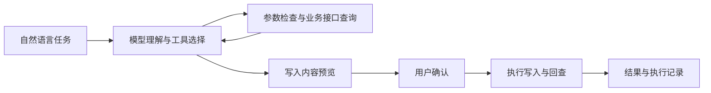

<div align="center">

# Relay

**给它一个业务任务，让 AI 帮你查询信息、创建记录、串联多个系统完成工作。**

一个可配置的企业业务 Agent 工作台。连接模型和业务 API 后，用自然语言提出需求，查看执行步骤，核对写入内容，并回查实际结果。

[在线 Demo](https://lazyz4.github.io/relay-agent-workbench/) · [快速开始](#快速开始) · [使用说明](使用说明.md) · [接口配置](#接入业务系统) · [验收步骤](验收步骤.md)

</div>

## 在线预览

打开 **[Relay 在线交互 Demo](https://lazyz4.github.io/relay-agent-workbench/)**，无需安装即可体验任务查询、需求预览确认、周报保存和执行记录。

公开预览使用浏览器内示例数据与预设流程，**不调用真实模型或外部业务 API，不接收 API Key**，刷新后重置。完整自由对话、模型配置、业务接口接入及真实验收请下载本地运行。预览源码与说明见 [docs/](docs/README.md)。

## 它能帮你做什么

| 你说 | Relay 执行 | 你得到 |
|---|---|---|
| 「看一下星河项目还有哪些任务没完成」 | 查询研发系统，整理真实任务数据 | 带编号和状态的任务清单 |
| 「把这段反馈整理成一条需求」 | 提取项目、标题和描述，补问缺失信息，展示预览 | 确认后创建的需求与回查结果 |
| 「把已完成任务整理成周报，保存到文档系统」 | 查询任务、生成正文、请求确认、调用文档接口并回查 | 可在目标系统找到的周报草稿 |

Relay 通过已注册工具执行操作。模型选择工具和参数，程序负责校验、确认、实际调用和记录。没有接入的接口不会凭空出现；模型失败也不会用固定成功回答代替真实执行。

## 核心流程



查询按工具配置执行。创建记录前先核对内容；确认后执行，并通过业务编号回查。模型中断后可以恢复对话并继续任务，写入结果不确定时会提示核查。

## 快速开始

需要 **Python 3.10+**。仅使用 Python 标准库，无需安装 pip 依赖。

1. 下载或克隆仓库。
2. Windows 双击 `start-relay.cmd`，也可在项目目录运行 `python launch.py`。
3. 等待 `Relay ready`，浏览器打开 `http://127.0.0.1:8875/`。保持启动窗口开启。
4. 点击输入区的「配置模型」，选择模型服务、填写 API Key、地址和模型 ID，保存并测试连接。
5. 先查询任务，再尝试创建需求或保存周报。

```text
python launch.py
```

`127.0.0.1` 是运行程序的那台电脑。其他人需要在自己的环境启动，或使用另行部署的服务地址，不能通过这个链接访问你的电脑。

## 模型配置

支持供应商下拉选择、用户 API Key、自定义 Base URL、协议选择、模型列表读取与手动填写。

| 选项 | 用途 |
|---|---|
| DeepSeek | 使用自己的 DeepSeek API |
| Anthropic / Claude | 使用 Messages 协议服务 |
| 其他兼容 API / 企业网关 | 配置 Chat Completions 或 Messages 兼容服务 |
| Ollama 本地 | 连接本机已运行的模型服务，可不填 Key |

模型必须支持工具调用。读取到模型列表、连接测试成功、业务任务完成是不同阶段，需要分别验证。仅提供其他私有协议的服务仍需适配。

Key 默认只保存在服务内存中；Windows 环境支持时，可选择加密记住配置。更换供应商或服务地址不会自动把旧 Key 带给新服务。

## 接入业务系统

模型 API 负责理解和规划，业务 API 负责实际查询与写入，两者分别配置。

在「连接器」中添加工具，或导入 OpenAPI 3 JSON 生成配置草稿。审核参数、授权和回查方式后保存。工具说明告诉模型何时使用，服务端仍须负责权限和业务校验。

当前支持：

- GET 查询、POST JSON 写入和字符串参数。
- Bearer 授权环境变量、简单字段重命名和响应封装提取。
- 写入预览、逐次确认、幂等键、结果回查和执行记录。
- OpenAPI 内联对象与字符串参数子集；不兼容项会明确提示。

如果真实系统的接口和授权满足上述格式，常见操作可以通过配置接入。OAuth、特殊签名、复杂参数、多阶段审批等场景需要进一步适配。连接业务接口不等于完成企业级权限和部署。

## 页面与工具

| 页面 | 功能 |
|---|---|
| 工作助手 | 提出任务、补充信息、核对预览、确认执行 |
| 连接器 | 业务工具配置、接口导入草稿和连接测试 |
| 业务数据 | 查看演示系统实际保存的任务、需求和文档 |
| 执行记录 | 核对工具调用、确认状态和回查结果 |
| 接口演示 | 手动调用业务工具，排查接口，不使用模型 |
| 验收中心 | 分别验证执行机制和真实模型能力 |

内置工具：`list_tasks` 查询任务、`create_requirement` 创建需求、`list_documents` 查询文档、`create_document` 保存文档。详细参数见 [使用说明](使用说明.md)。

## 内置演示与验收

项目附带研发和文档两个独立演示服务，分别使用独立数据库。数据为虚构，HTTP 调用、写入和回查真实执行，可用来验证跨系统流程。

**工程验收**不调用模型，检查查询、确认/回查/去重、跨服务保存、取消和缺参拒绝。

**真实模型验收**实际调用所选 API，运行查询、创建需求、跨系统周报三个任务，会产生模型费用。验收写入只允许内置本地演示服务中的带标记测试记录。

```text
python -m unittest -v test_app.py test_providers.py
```

当前检查记录为 30 项自动化检查中 29 项通过、1 项 Windows 加密检查因受限环境跳过；独立服务工程验收 5/5。预设模型响应只用于协议测试，不能替代真实模型验收。不同供应商和本地模型需分别进行实际测试。

## 目录结构

```text
relay-agent-workbench/
├── launch.py                 启动与进程管理
├── app.py                    工作台与 Agent 执行
├── providers.py              模型协议适配
├── integrations.py           接口文档导入
├── evaluate.py               验收流程
├── vault.py                  Windows 加密存储
├── index.html                前端工作台
├── connectors.json           默认演示工具配置
├── openapi-example.json      接口文档示例
├── test_app.py               执行机制测试
├── test_providers.py         模型协议测试
├── 使用说明.md
├── 验收步骤.md
└── 企业部署改造清单.md
```

## 使用范围

当前版本是单用户本地 MVP。尚未实现企业 SSO、多租户隔离、完整员工权限、生产并发与集中凭据管理。企业使用前应在授权测试环境验证，并完成 [部署改造](企业部署改造清单.md)。

完整使用说明包含联网排查、连接器字段、失败恢复和 GitHub 发布方法。请勿上传运行目录 data/、数据库、日志、密钥或公司的内部资料。

## 文档

- [使用说明](使用说明.md)
- [验收步骤](验收步骤.md)
- [企业部署改造清单](企业部署改造清单.md)
- [开发与反馈](CONTRIBUTING.md)

## 许可

见 [LICENSE](LICENSE)。
